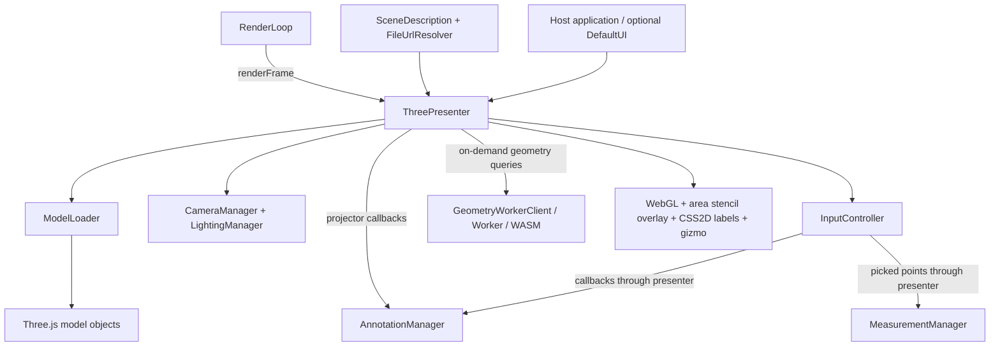

# ThreePresenter Architecture

ThreePresenter is a framework-agnostic browser library for displaying and interacting with 3D models. Applications describe scenes with JavaScript data, mount a presenter in a DOM element, and connect their own controls and persistence through methods and callbacks.

This guide describes the current working tree, based on the source, source comments, and local Git commit messages through `09e7092`. It also includes the pending area-adaptation and projection-diagnostic changes. Those pending APIs are not necessarily available in the published npm release. Design intent below is derived from the implementation and commit history; it is not a separate historical specification.

For annotation algorithms and editing behavior, see [Line and Area Annotations](ANNOTATIONS.md). For individual signatures, consult the generated API documentation or [public exports](../src/index.ts).

## Design Principles

### Describe content separately from the current view

`SceneDescription` describes models, transforms, environment settings, and initial annotations. Runtime Three.js objects live inside the presenter. `PresenterState` captures a smaller set of viewing preferences: camera position/target/FOV, lighting toggles, and model visibility.

This separation allows an application to reuse scene content while restoring a user's view. It is not a complete serialization system: `getState()` does not include annotation edits, measurements, active tools, or all camera settings. Applications must store those separately.

The scene description is also not immutable in the current implementation. `loadScene()` retains it, and automatic framing can write computed positions into model definitions. Pass an application-owned copy if the original description must remain unchanged.

### Compose specialized managers behind one public controller

`ThreePresenter` is the high-level entry point and coordination layer. Managers isolate loading, camera behavior, input, annotations, lighting, measurement, and animation scheduling. Input callbacks connect these pieces without giving the input controller a direct dependency on the presenter.

The separation is practical rather than complete. The presenter still implements surface raycasting, area-fill generation, stencil rendering, environment loading, and geometry-worker coordination. A new feature should normally extend the manager that owns its state, with the presenter supplying scene/camera-dependent work.

### Keep application integration explicit

The core does not require React, Vue, or another UI framework. `DefaultUI` is an optional consumer of the presenter API. An application can use the same API with its own buttons. `FileUrlResolver` separates model identifiers and relative paths from hosting or backend URL conventions.

Annotation creation emits geometry to the host application. The host assigns identifiers, stores records, and supplies annotations for rendering. This makes persistence policy an application concern rather than coupling the viewer to a particular backend.

### Reuse Three.js and keep expensive geometry work optional

Three.js is a peer dependency and is externalized from the library bundle. A plain browser example therefore uses an import map for `three` and `three/addons/`; a consuming bundler can resolve these imports instead.

Geodesic processing is loaded on demand through the separate geometry module. Its worker and WebAssembly core keep that computation off the UI thread. Camera raycasts and area sampling currently execute on the main thread.

## Components and Responsibilities

| Component | Responsibility |
| --- | --- |
| [ThreePresenter](../src/ThreePresenter.ts) | Owns scene/renderers, coordinates managers, loads scenes, exposes application APIs and callbacks, runs extra rendering passes. |
| [CameraManager](../src/managers/CameraManager.ts) | Camera setup, perspective/orthographic behavior, framing, and camera state. |
| [ModelLoader](../src/managers/ModelLoader.ts) | Format-specific loading and parsing, materials and associated resources; supports GLTF/GLB, PLY, OBJ bundles, and Nexus streaming. |
| [LightingManager](../src/managers/LightingManager.ts) | Lighting objects and lighting state. The presenter also coordinates environment-map loading. |
| [InputController](../src/managers/InputController.ts) | Pointer/keyboard handling, raycast picking, drawing/edit gestures, and interaction callbacks. |
| [AnnotationManager](../src/managers/AnnotationManager.ts) | Annotation copies, selection, drafts, edits, boundary rendering, handles, and projector hooks. |
| [MeasurementManager](../src/managers/MeasurementManager.ts) | Two-point measurements, temporary endpoints, line/marker geometry, and DOM labels. |
| [RenderLoop](../src/managers/RenderLoop.ts) | Animation-frame scheduling and registered callbacks. |
| [DefaultUI and skin utilities](../src/ui/DefaultUI.ts) | Optional controls, state synchronization, and SVG/CSS appearance. |
| [Geometry module](../src/geometry/index.ts) | Mesh extraction, worker protocol/client, and approximate surface-path queries. |

The constructor accepts optional replacements for `modelLoader`, `lightingManager`, `cameraManager`, `measurementManager`, and `renderLoop`. `InputController` and `AnnotationManager` are created internally. Replacement managers must be compatible with the presenter's scene and lifecycle; the presenter disposes the managers it uses, including injected ones.

## Scene and Interaction Lifecycle

Construction creates the Three.js scene, WebGL and CSS2D renderers, managers, input callbacks, and render loop. The mount must be a browser DOM element or its ID.

`loadScene(description)` clears the previous scene, applies environment settings, configures controls, loads models, frames the scene, and renders initial annotations. The optional `preserveCamera` argument retains the current position and target across the reload.

Model transforms and coordinate conventions matter for integration. Models without explicit positions can be automatically placed during framing. Picking returns world-space positions after those transforms. Annotation geometry is stored in world space and has no persistent model/triangle attachment; moving a model does not automatically move its annotations. See the annotation guide before implementing save/restore or model manipulation.

Input interpretation depends on the active mode:

- Normal interaction supports navigation, annotation selection, and enabled annotation edits.
- Point creation emits a picked point and returns to normal interaction.
- Line and area creation collect control points until completion or cancellation; creation mode remains active for another draft.
- Measurement mode collects successive pairs of points and creates straight Euclidean distances in world units, displayed with CSS2D labels.

Entering annotation creation exits measurement mode; entering measurement exits annotation creation. An annotation drag temporarily locks camera controls. These transitions are coordinated by the presenter.

Each frame updates controls and model-specific updates, refreshes camera-dependent area data, renders the scene and area overlay, renders DOM labels, then renders the viewport gizmo. The loop runs continuously; it is not currently an on-demand renderer.

When unmounting, call `dispose()` on an independently created `DefaultUI` and call `presenter.dispose()`. Disposal stops the loop, removes listeners and renderer DOM elements, and disposes managers and the geometry worker. Host-side subscriptions and persistence remain the application's responsibility.

## Geometry Processing Boundary

The geometry backend uses a snapshot of visible triangle meshes transformed into world coordinates. Extraction accepts indexed and non-indexed triangle geometry and skips unsupported instanced meshes and invalid geometry. It is a static snapshot, not a live binding to changing geometry or Nexus streaming data.

The worker protocol uses request IDs and transferable arrays. The generated VCGlib-based WASM core computes approximate paths on the registered mesh; the presenter joins results between consecutive controls. Scene replacement, presenter-managed transforms, and visibility changes invalidate the cached surface. Direct external mutations require care because they can bypass that invalidation.

The backend is not an exact global shortest-path guarantee or a general surface-region representation. See [WASM build notes](../wasm/README.md) and [annotation adaptation](ANNOTATIONS.md#view-and-geodesic-adaptation).

## Repository and Build Boundaries

| Location | Role |
| --- | --- |
| `src/` | TypeScript library source; public entry points are `index.ts` and `geometry/index.ts`. |
| `src/managers/`, `src/ui/`, `src/types/`, `src/utils/` | Runtime subsystems, optional controls, data contracts, and shared algorithms. |
| `src/geometry/`, `wasm/` | Worker integration and native geometry core/build instructions. |
| `docs/examples/`, `docs/assets/` | Small integration examples and sample assets. |
| `scripts/` | Build coordination, example metadata generation, smoke checks, and geometry tooling. |
| `tests/` | Node tests for annotation behavior, area utilities, and geometry processing. |
| `dist/`, `docs/dist/`, `docs/api/` | Generated library, demo bundle copy, and TypeDoc output. |

`npm run build` builds the library, regenerates `docs/examples/examples.json`, and copies the bundle to `docs/dist/`. `build:docs` currently delegates to the same command. `serve:docs` serves `docs/` at port 8080; the example catalog is `/examples/index.html`.

`npm run dev` performs an initial build, generates API docs, starts Vite with `docs` as its root, and watches TypeScript files in `src/` to rebuild the library. Examples import the generated bundle. Updating example HTML alone does not regenerate its embedded source in `examples.json`; a build does. The current watcher also skips a build request if another build is already running, so it does not guarantee that every rapid edit is queued. When diagnosing a mismatch, inspect the served module and build output rather than inferring the loaded version from the HTML.

Baseline checks are `npm run build` and `npm run smoke:assets`; `npm test` additionally runs the Node tests. These checks do not substitute for browser verification of raycasting, stencil overlays, or UI interactions. GitHub Pages uses the deploy workflow and generated docs; npm publication uses the library output.

## Decisions Recorded in Git

The hashes below identify commit subjects and bodies used to reconstruct the design. Run `git show <hash>` to inspect their original changes.

| Commit | Recorded change and architectural significance |
| --- | --- |
| `352987a` | Introduced core library, managers, types, utilities, and a minimal example: the modular structure was present early. |
| `7c970d0` | Delegated camera framing to `CameraManager`. |
| `5ec4a35` | Switched examples to standalone `DefaultUI`, demonstrating the optional UI boundary. |
| `500e562` | Consolidated build, watch, docs, and deployment tooling. |
| `edbc083` | Added an IIIF parser that converts external data into the internal scene description. |
| `2d69b72` | Added a measurement manager and modal picking with CSS2D labels. |
| `d257477`, `fee3b34` | Added UI skins and synchronized toggle state through shared styling. |
| `639bd65` through `45f403f` | Extended annotations from draft creation to editing, areas, and explicit adaptation. See the annotation guide's history table. |
| `09e7092` | Added the WASM surface-path backend, worker integration, diagnostics, and geometry exports. |

## Current Design Limits

The public controller contains substantial geometry/rendering logic despite the manager-based structure. Treat further extraction as a design opportunity, not an existing abstraction.

Annotation types currently exist in both `types/SceneTypes.ts` and `types/AnnotationTypes.ts`; the latter includes `surfacePath`, while the package-root `Annotation` export comes from the former. Applications must preserve control metadata explicitly until these contracts are unified.

Area interiors are camera-dependent visualizations, not stored mesh regions or physical area measurements. Geodesics use a static approximate backend. The annotation guide describes these limits in detail so integrations do not assume stronger guarantees.
